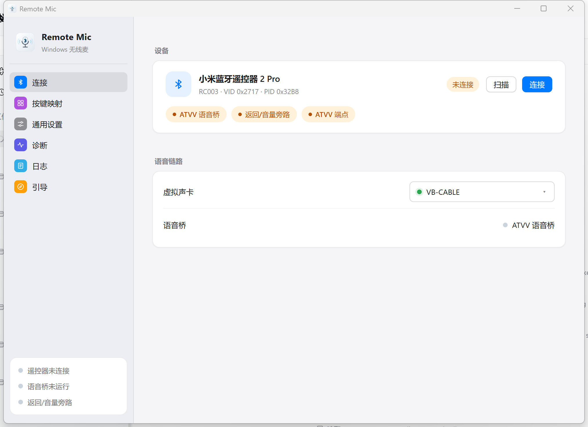
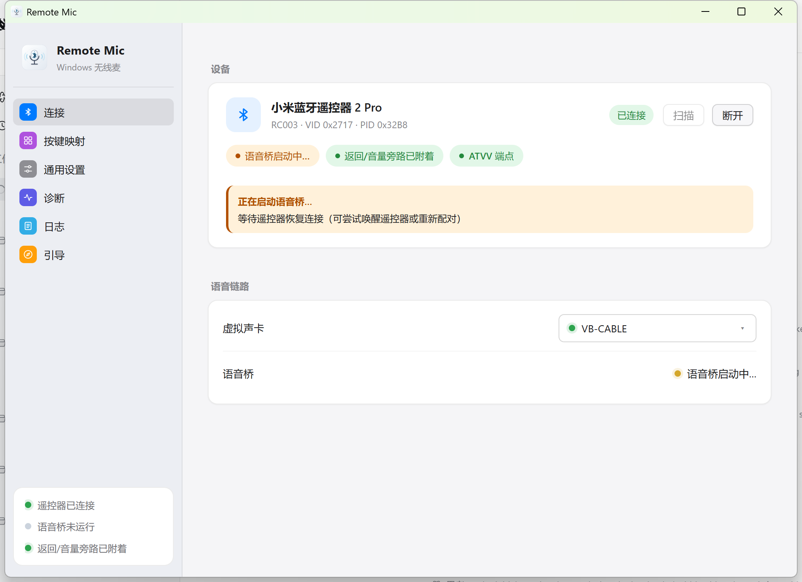
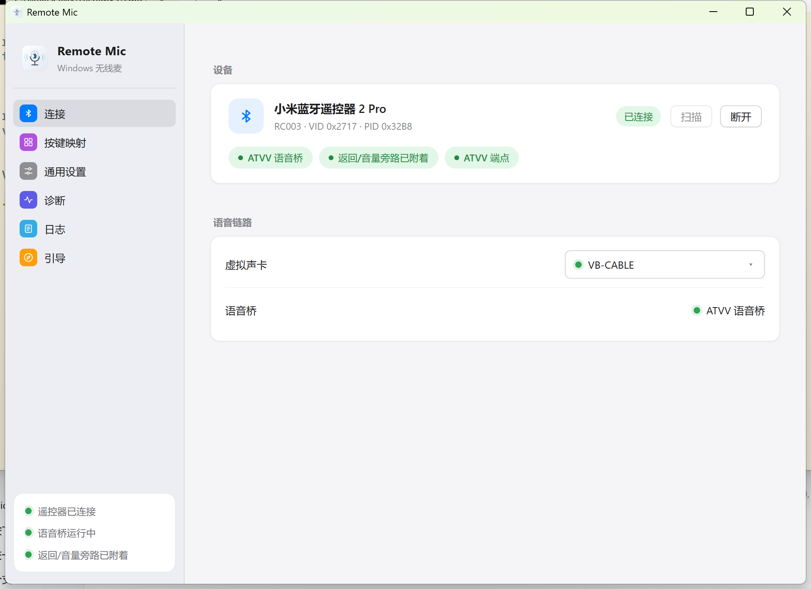
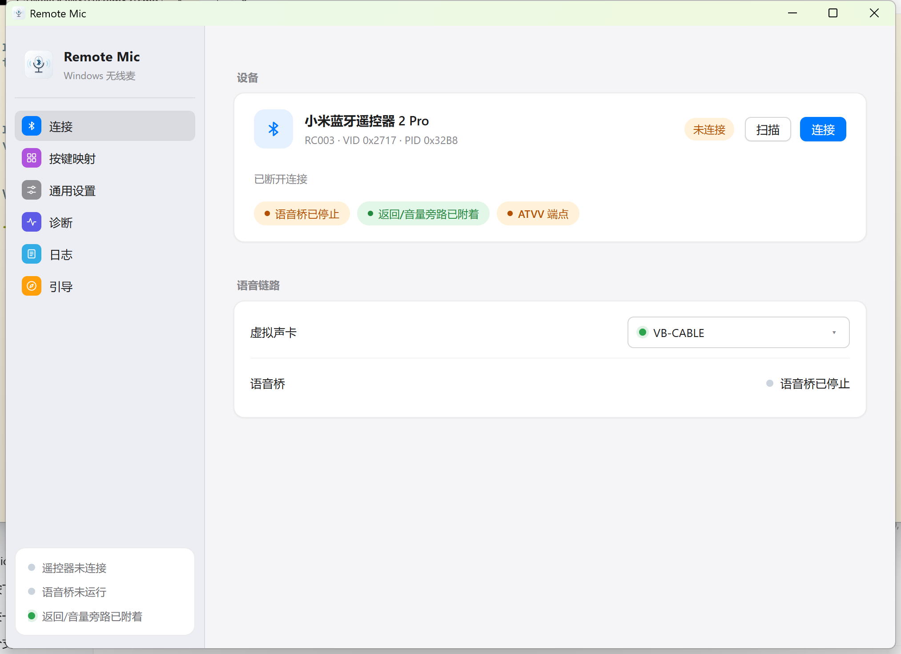
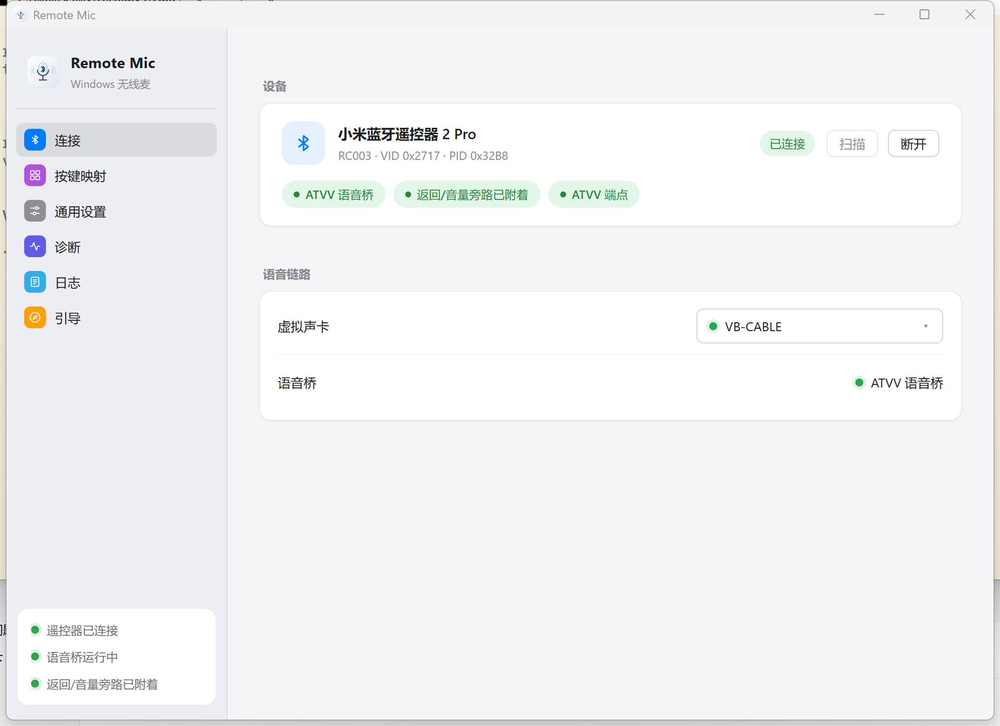
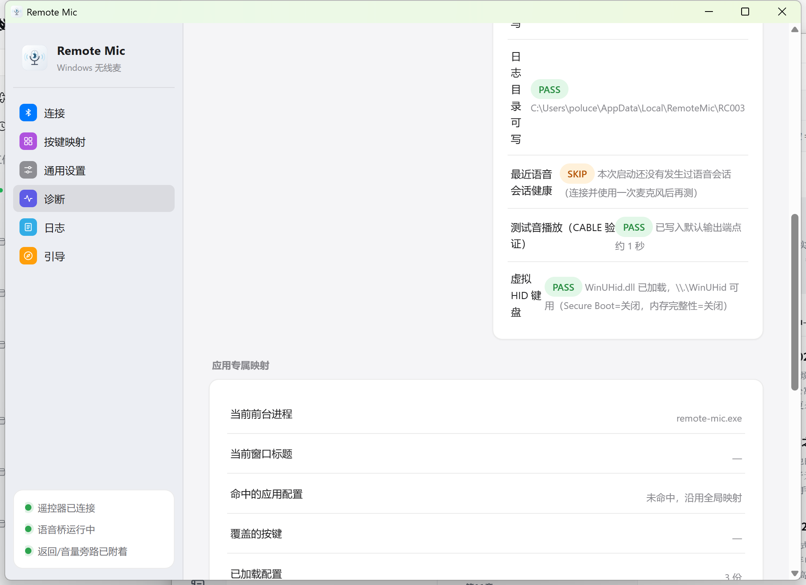
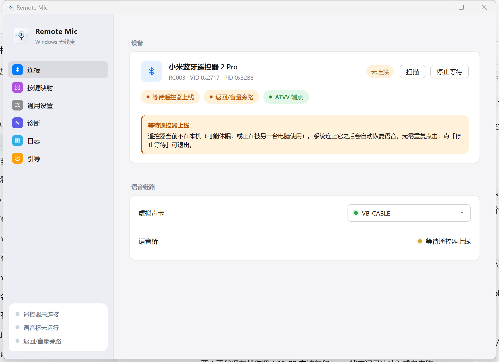
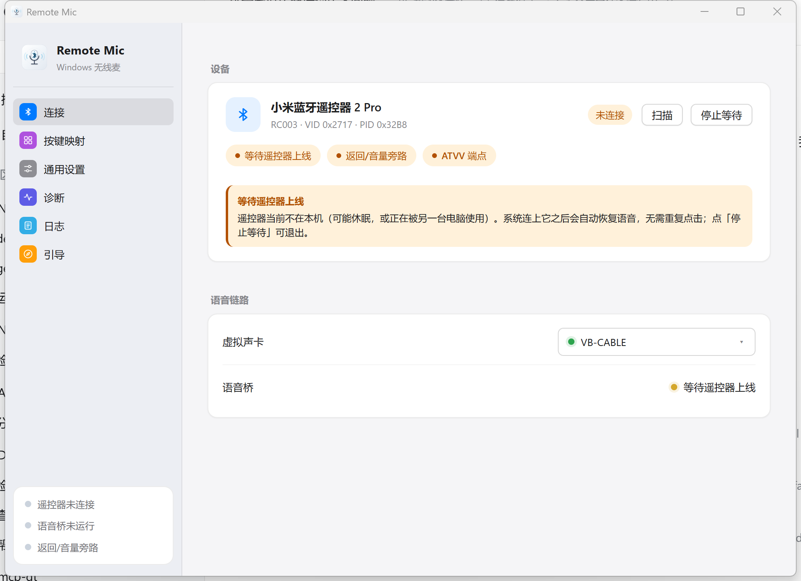
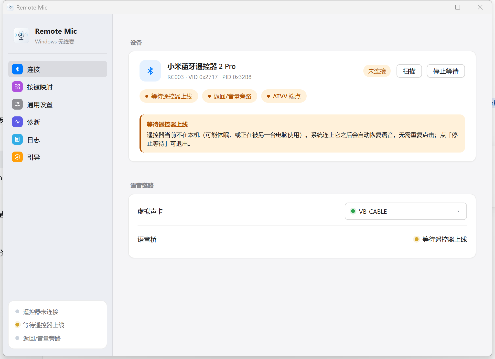

# Remote Mic 容错能力评估

> 评估对象：Remote Mic v0.5.0（分支 `fix/virtual-key-stuck-release`，工作区含未提交卡键修复）
> 评估日期：2026-10-19
> 评估方法：全量代码审查（14.5k 行 Rust + 3.6k 行前端）+ 本地测试运行（167 passed / 0 failed）+ 48.7 小时真实运行日志分析 + 近三次真实故障回溯
> 结论：**「关键后果兜底」已达到较高水平，"系统级韧性"只能算中等**。最严重的全局卡键问题已被多层兜底覆盖；但自愈能力、超时边界、线程监督、资源上限、用户可见告警仍是明显短板。

---

## 1. 总体结论

| 维度 | 评分 | 说明 |
| --- | --- | --- |
| 输入注入 / 防卡键 | ★★★★☆ | 事故后补齐了 5 条独立兜底路径，实测 46 小时无卡键 |
| 配置 / 日志持久化 | ★★★☆☆ | 原子写、轮转、损坏回落都有；但无备份、IO 失败静默 |
| BLE 链路 | ★★★★☆ | 已加 WinRT 超时、CCCD/open 状态校验；仍缺「零数据自动复位」 |
| ATVV 音频链路 | ★★★☆☆ | 时钟语义修复、输出流错误可提示；握手（MIC_OPEN/CLOSE）仍未接 |
| 音频输出 | ★★★☆☆ | 严格设备匹配、队列封顶；仍无设备热插拔重建 |
| HID 旁路（Frida） | ★★★★☆ | IPC 读超时、线程 panic 自愈、日志限流已加 |
| 前端 | ★★★★☆ | 重连/失败/停止结果可见；仍缺 ErrorBoundary 与自动重连 |
| 可观测与自愈 | ★★★★☆ | panic 落盘、看门狗补释放、日志降噪；仍无指标面板 |
| 自动化测试 | ★★★☆☆ | 纯逻辑覆盖好（167 用例、CI 全绿）；硬件相关层零测试 |

**一句话**：单点故障大多"不会造成系统级灾难"，但大量失败是**静默降级**——用户与开发者都要靠翻日志才发现（本次排查就是靠日志里的"距上次控制=从未"才定位到远端固件挂起）。

---

## 2. 做得好的部分（真实有效）

1. **防卡键多层兜底（本项目最关键的容错）**
   - HOGP 驱动层看门狗：普通键 2s、麦克风键 10s 自动补发松开（`core-hid/src/tap.rs:27,30,683-728`）。
   - ATVV `AudioStopped` 联动释放麦克风键（`tap.rs:827-850`）。
   - 组合键按住上限 10s 强制释放（`core-dispatch/src/lib.rs:50,579-597`）。
   - 会话结束 / 暂停调度 / 切换输入模式 / 应用退出都会强制释放（`core-dispatch/src/lib.rs:441-473`、`src-tauri/src/lib.rs:71-85,573-579`）。
   - 松开时复用"按下时记住的 token"，避免映射热更新导致松开解析成另一组键（`core-dispatch/src/lib.rs:656-670`）。
   - 虚拟 HID 释放时**无条件**提交全零报告，清 OS/驱动层残留（`core-input/src/vhid.rs:381-428`）。
2. **配置原子写**：临时文件 + fsync + rename，崩溃不产生半个 JSON（`core-config/src/lib.rs:144-165`）。
3. **Frida Gadget 供应链**：SHA-256 校验、curl connect-timeout、System32 工具优先、安装包内置压缩包回退（`core-hid/src/gadget_fetch.rs`）。
4. **协议解析防越界**：`parse_control` / `parse_caps` 全量长度检查，不 panic（`core-atvv/src/protocol.rs:63-147`）。
5. **UI Automation 超时**：连接/事务超时 2s、COM 套间正确处理、Document 兜底（`core-input/src/uia.rs`）。
6. **GATT 打开多级回退**：缓存→非缓存；共享读写→只读→未指定（`core-ble/src/gatt.rs:136-145,221-247`）。
7. **日志轮转**：2MiB 轮转、保留 5 份、UI 实时订阅（`core-log`）。
8. **CI 完整**：fmt + clippy(-D warnings) + test + tauri check + 前端 typecheck/build（`.github/workflows/ci.yml`）。
9. **实测稳定性**：本次 10-17 12:53 启动后连续运行 48.7 小时，ATVV 会话存活 166,770s（约 46.3 小时）不断连；期间 0 次看门狗触发、0 次强制释放、0 次崩溃；语音链路实测可用（10-17 12:54 收到 221 帧 120B ADPCM，15:01 又录到 439KB 音频抓包）。

---

## 3. 主要容错缺口（按严重度）

### P0 — 可能造成系统级影响 / 长期静默失效 / 数据丢失

| # | 缺口 | 证据 | 后果 |
| --- | --- | --- | --- |
| 1 | **无 panic hook、无 catch_unwind**；两个 Win32 回调（`WH_KEYBOARD_LL`、`WM_INPUT`）内部含 `.lock().unwrap()` | `src-tauri/src/lib.rs` 全局无 `catch_unwind/set_hook`；`core-input/src/hook.rs:80-121`、`core-hid/src/raw_input.rs:285,329,351` | 任何一处 mutex 中毒 panic 跨 FFI 边界 → 进程 abort/UB；abort/强杀时退出兜底不执行 → **虚拟键残留（即最初那类故障）** |
| 2 | **CCCD 通知启用不校验状态**：`enable_notifications` 只写不查 result；`open_atvv_service` 三种模式全失败也返回 Ok | `core-ble/src/gatt.rs:368-383`、`221-247` | 链路"看起来连上了"但永远收不到通知；日志仍打印"音频通知启用成功" |
| 3 | **WinRT 异步调用全部无超时** | `core-ble/src/gatt.rs` 全程 `pollster::block_on`，无 timeout 包裹 | 设备/驱动卡死时桥线程无限阻塞；`stop_voice_bridge` 最多等 3s 就返回"已断开连接"（`commands/audio.rs:121-136`），实际停不掉 |
| 4 | **重连循环无上限、无抖动、无用户可见失败态** | `commands/audio.rs:36-110`（attempt 无限增长，退避封顶 10s）；前端 `BridgeStatus` 声明了 `"failed"` 却从未赋值（`src/store/runtimeStatus.ts:5`） | 实测曾连续空转约 26 小时、1000+ 次重连全部 0 包（10-16 08:00 时计数已到 672）；UI 只显示 idle/running 切换 |
| 5 | **无单实例保护** | 全仓库无 `single_instance` 插件/互斥量；`BRIDGE_RUNNING` 只是进程内静态量 | 双开 → 两个桥、两套钩子、两次 Frida 注入争用同一 BLE 链路 |

### P1 — 功能性静默降级 / 资源无界 / 自愈缺失

| # | 缺口 | 证据 | 后果 |
| --- | --- | --- | --- |
| 6 | **音频输出队列无上限、无背压/延迟控制；设备丢失不重建** | `core-audio/src/sink.rs:13,65-69`（`VecDeque<f32>` 无 cap）；`err_fn` 只写日志（`sink.rs:37`） | 输出设备被禁用/拔出后回调停摆，队列按 48k×2ch×4B ≈ 384KB/s 无界增长；延迟也只增不减 |
| 7 | **找不到指定音频设备时静默回退系统默认输出** | `core-audio/src/playback.rs:87-104`：`pick_output_device(Some("CABLE Input"))` 找不到就返回 default。桥接层仍打印"音频输出已初始化：CABLE Input"（`bridge.rs:163-169`） | VB-CABLE 被卸载/改名/禁用时，遥控器声音从**扬声器**放出（啸叫/隐私），豆包完全收不到，日志却"一切正常" |
| 8 | **配置损坏静默回落默认，且下次保存即覆盖** | `core-config/src/lib.rs:127-142`；启动与命令层普遍 `load_or_default()` / `load().unwrap_or_default()` | 一次 JSON 损坏 = 用户全部映射/校准静默丢失，无备份、无提示 |
| 9 | **HOGP 旁路 IPC 无读超时、无心跳存活检测** | `core-hid/src/tap.rs:533-535` 显式 `set_read_timeout(None)`，注释依赖 5s 心跳但代码从不检查心跳缺失 | Frida/WUDFHost 侧卡死（进程挂起但 socket 未关）→ `serve_client` 永久阻塞：不再重新注入、不再检测宿主 PID 变化，只有重启应用能恢复 |
| 10 | **eat 模式对所有报告一刀切清零**（含 60 字节语音类报告） | `core-hid/src/rc003_hid_tap.js:187-205`（len 1–64 全部清零）；实测 10-17 00:55 麦克风按住时遥控器走 HOGP 发 60B 语音兜底报告，被全部吃掉 | 遥控器 ATVV 不健康时的唯一兜底通道被本应用销毁（且 896 条 INFO 日志刷屏） |
| 11 | **调度 tick 每 25ms 查前台进程名/窗口标题，无缓存** | `core-dispatch/src/lib.rs:42,225-228,565`；`core-app-profile/src/foreground.rs:7-19,34-56`（OpenProcess + QueryFullProcessImageName + GetWindowTextW 全量执行） | 每秒 40 次跨进程查询；前台应用卡死时 `GetWindowTextW` 可能阻塞 tick 线程 → 单击/长按判定延迟 |
| 12 | **执行线程 / tick 线程无监督** | `core-dispatch/src/lib.rs:330-352,757-786`；线程 panic 后无人重启，任务进无界 channel（`:177`）堆积 | 一次 panic = 所有按键动作静默失效，后续任务在内存里越积越多 |
| 13 | **日志无速率限制；热路径 INFO 过密** | 吃掉报告每条 INFO（`tap.rs:632-634`）；实测两次按住说话（各约 2 秒）产生 **896 行**；ATVV 恢复正常后 60B 兜底报告消失，说明它确实是 ATVV 不健康时的降级通道；30s 空闲心跳 INFO（`bridge.rs:296-309`）占日志大头 | 日志被噪音淹没（本次排查翻 2MB 日志找线索）；写盘频率抬高 HID 路径延迟；轮转过快丢失关键上下文 |
| 14 | **统计在动作热路径同步读写 JSON** | `core-dispatch/src/lib.rs:780-784` → `core-stats/src/lib.rs:78-92`（每次按键：读文件+解析+写临时文件+rename），失败被 `let _ =` 吞掉 | 每次按键 2 次文件 IO；失败后统计静默停更 |
| 15 | **无自动重连**：`selected_device_id` 只写不读 | `core-config/src/lib.rs:42` 注释"预留：暂无自动重连读取路径"；前端从未读取该字段 | 重启应用/重启电脑后必须手动点"连接"，与"断线自动重连"的体验不一致 |

### P2 — 兼容性 / 体验 / 可维护性

| # | 缺口 | 证据 |
| --- | --- | --- |
| 16 | CAPS 返回的 `frame_size` 被忽略，帧长硬编码 120B | `core-voice/src/lib.rs:12,104`；`protocol.rs` 解析出的 `frame_size` 无用例；文档已列出 126/134/160 变体固件 |
| 17 | ATVV 会话握手不完整：`MIC_OPEN/MIC_CLOSE/MIC_EXTEND` 有实现但**从未调用** | `core-atvv/src/protocol.rs:34-49` 全仓库零调用（除测试）；桥接只在开始发一次 CAPS 查询，断开时不发 MIC_CLOSE。与 10-15 实测"遥控器语音固件挂起、需抠电池复位"直接相关 |
| 18 | `VoiceEngine.now_ms` 从不推进 → 基于时间的尾音丢弃/会话归位逻辑形同虚设 | `core-voice/src/lib.rs:106,111-113`；`advance()` 仅测试调用；`session.rs:11,98-121` 的 `STOP_TAIL_DROP_MS` 实际永远"在窗口内" |
| 19 | 无重采样/格式协商：只接受 F32，直接用设备默认采样率 | `core-audio/src/sink.rs:27-33`；CABLE 默认格式被改成 44.1k 时会变调，16bit 时直接失败 |
| 20 | 前端：无 connect 超时/取消、`markConnected` 乐观置位、无 ErrorBoundary | `src/pages/ConnectionPage.tsx:107-147`；`src/store/runtimeStatus.ts:117-123`；`grep ErrorBoundary` 无结果 |
| 21 | 自检未覆盖关键链路：VB-CABLE 绑定、ATVV 通知是否真的到达、tap 状态、配置/日志可写性 | `src-tauri/src/commands/diagnostics.rs:15-158` |
| 22 | 硬件相关层零自动化测试 | 无测试文件的模块：`core-ble/{gatt,winrt}`、`core-audio/{sink,playback,endpoint,wasapi}`、`core-hid/raw_input`、`core-input/{hook,lib}`、`core-voice/bridge` 等 19 个文件；5 个真机测试被 `#[ignore]` |

---

## 4. 真实故障回溯 × 当前容错能力对照

| 事件 | 现象 | 当时的容错缺口 | 现状 |
| --- | --- | --- | --- |
| 2026-10 虚拟键卡死 | 遥控器断链后 rctrl 一直按住，物理键盘失灵 | 看门狗忽略 0x3E、AudioStopped 无释放、组合键上限 120s、`release_all` 有脏标记才发零报告 | ✅ 已补齐 5 条兜底；实测 46h 无复发。⚠️ 但崩溃/强杀路径仍无兜底（无 panic hook） |
| 2026-10-15 ATVV 语音服务挂起 | 连续约 26 小时、1000+ 次重连全部 0 包（10-16 08:00 已 672 次），遥控器 caps 只在断链瞬间才吐出 | 无 MIC_CLOSE 握手、无"链路通但零数据"检测、无自动复位（重连同一条死链路） | ⚠️ 未修：靠用户抠电池复位；代码侧仍无检测/自愈 |
| 2026-10-16 通知被压到断链才送达 | 抓包文件有 caps/音频帧，但全部落在 disconnect 时刻 | `enable_notifications` 不校验状态、无通知延迟指标、无链路质量探测 | ⚠️ 未修（仅加了诊断心跳日志） |
| 2026-10-17 Win+H 不弹 | 语音条不出现 | 与程序无关（TextInputHost 假死 + 需输入框焦点） | — 外部因素 |

---

## 5. 改进建议（按优先级）

### P0（建议尽快）
1. **加 panic hook + `catch_unwind`**：`std::panic::set_hook` 里落日志并在 `RunEvent::Exit`/hook 内调用 `force_release_held_keys`；FFI 回调体用 `catch_unwind` 包住，避免跨边界展开；关键 mutex 用 `lock().unwrap_or_else(|e| e.into_inner())`（`core-voice` 已有此写法，可推广）。
2. **校验 CCCD 写入与 open 结果**：`enable_notifications` 检查 `GattCommunicationStatus == Success`，否则返回 Err；`open_atvv_service` 三种模式全失败必须返回 Err；并在 10s 内未收到首个 caps 响应时主动"重订阅→重连→提示用户"。
3. **给所有 WinRT 操作加超时**：`tokio::time::timeout` 或 `wait_timeout` 包裹 `block_on`；`stop_voice_bridge` 改为返回真实结果（是否在期限内停止），前端显示"正在停止…/停止失败"。
4. **重连策略**：指数退避（10s→30s→60s→300s 封顶）+ 随机抖动；连续 N 次失败后置 `BridgeStatus::failed` 并给前端一次性可见提示（含"检查遥控器是否开机/重新配对"引导）；加单实例互斥（命名 mutex 或 Tauri single-instance 插件）。
5. **音频输出兜底**：`AudioSink::new(Some("CABLE Input"))` 找不到设备必须 **返回错误**（或显式警告 + 前端红条），禁止静默回退默认设备；队列加 cap（如 1s = 48k 样本），超限丢旧帧/清空重同步；监听 stream error → 自动重建 + 状态上报。

### P1（下一迭代）
6. 配置写入前保留 `config.json.bak`（last-known-good），加载失败时尝试恢复并提示；日志写失败（磁盘满/权限）在 UI 上给出一次告警。
7. tap IPC 加读超时（如 15s 无心跳视为断链）+ 宿主 PID/心跳监控；`serve_client` 返回后自动重连并重新注入。
8. eat 模式白名单化：只清零含按键 usage 的报告（如 8/20 字节键报告），60B 语音类报告放行；`eaten_report` 降为 DEBUG 或按秒限流。
9. 前台配置查询缓存（进程名 1s 级、标题变更事件驱动），tick 线程不做跨进程 `GetWindowTextW`。
10. 执行/tick 线程加 `catch_unwind` + 自动重启 + 队列水位告警；`jobs_tx` 改有界 channel，满时丢弃并计数。
11. 统计改为内存累计、定时落盘（如 5s 或退出时），不在按键热路径同步 IO。
12. 心跳日志降为 DEBUG/5 分钟一次；日志加"每类日志每秒上限"。

### P2（兼容性 / 可维护性）
13. 用 CAPS 的 `frame_size` 重建 assembler（保留 120 缺省），适配 126B 同步头固件。
14. 接入 MIC_OPEN/MIC_CLOSE 握手：桥接开始时 MIC_OPEN（或按真机时序），会话结束/断开前 MIC_CLOSE，降低远端固件挂起概率；若短期不敢发，至少在"首个 caps 响应超时"时提示用户"请重启遥控器"。
15. `VoiceEngine` 接入真实单调时钟（bridge 主循环喂 `advance`），让尾音门控与状态机时间语义真正生效。
16. 音频输出做采样率/格式协商（至少检测 44.1k 并 resample，或明确报错）。
17. 前端：connect 加 15s 超时 + 取消按钮；`markConnected` 改为等待桥会话首帧；加 ErrorBoundary；启动时若 `selected_device_id` 存在则自动尝试一次连接（失败回退手动）。
18. 自检项补充：CABLE Input/Output 配对、ATVV 通知链实测（发 CAPS 收 CAPS）、tap 状态、配置/日志可写性。
19. 为 `bridge` 编排逻辑抽纯函数做单元测试（状态迁移、失败注入），并把 `#[ignore]` 真机测试纳入发布前 checklist。

---

## 6. 测试与 CI 现状（本次实测）

- `cargo test --workspace --exclude remote-mic`：**167 passed / 0 failed**，5 个真机用例 `#[ignore]`。
- CI：fmt、clippy(-D warnings)、test、`cargo check -p remote-mic`、前端 typecheck/build 全都有；本工作区未提交改动未跑 CI（分支 `fix/virtual-key-stuck-release` 上 9 个文件改动尚未提交，CI 只验证已提交内容）。
- 覆盖特征：**纯逻辑/协议/配置/日志覆盖好；硬件与系统集成层（BLE、WASAPI、HID 注入、Frida 旁路）零自动化测试**，只有手工真机验收文档。

---

## 7. 附：本次评估采集的关键运行数据

- 日志跨度：2026-10-17 00:37 → 2026-10-19 13:34，9303 行；ERROR 22 条（全部为"遥控器未找到"扫描失败）、WARN 29 条。
- 当前实例：10-17 12:53 启动，连续运行 48.7h；ATVV 会话 166,770s 未断；最后一次音频 10-17 15:01。
- 卡键相关：`看门狗自动释放` 0 次、`强制释放` 0 次、`清空驱动层活跃按键` 0 次。
- 噪音：`吃掉报告 len=60` 896 条（全部来自 10-17 00:55 / 00:58 两次按住说话——ATVV 挂起、遥控器降级走 HOGP 语音期间；遥控器复位、ATVV 恢复后该报告不再出现）。
- 体验类：`扫描 RC003 失败: no matching remote device found` 22 次；`拒绝重复启动：语音桥循环已在运行` 7 次（前端重复点连接）。

---

## 8. 本轮已落地改进（2026-10-19）

> 对应第 3 节缺口编号；全部通过 `cargo fmt/clippy/test`、前端 typecheck/build，并已真机截图验证。

### 8.1 已修复（P0）

| 缺口 | 落地内容 | 位置 |
| --- | --- | --- |
| #1 panic / 卡键兜底 | 全局 `panic` hook（写 `panic.log` + 异步补发全部松开）；两个 Win32 回调（`WH_KEYBOARD_LL`、`WM_INPUT`）内 `catch_unwind` 隔离 panic；关键路径锁全部改为**中毒容错**（`unwrap_or_else(into_inner)`）；调度 tick/执行线程、旁路线程、看门狗、语音桥重连循环均加 panic 隔离与自愈重启；主线程卡死超 15s 自动补发一次强制释放 | `src-tauri/src/lib.rs`、`core-input/src/hook.rs`、`core-hid/src/raw_input.rs`、`core-dispatch/src/lib.rs`、`core-hid/src/tap.rs`、`core-voice/src/bridge.rs`、`commands/audio.rs` |
| #2 通知状态不校验 | CCCD 写入结果必须为 `Success` 否则返回错误；ATVV 服务三种共享模式全失败显式报错；TX 写入失败也上报 | `core-ble/src/gatt.rs` |
| #3 WinRT 无超时 | 新增 `async_wait::wait_op` 轮询式等待：设备打开 20s、GATT 发现 15s、轻量操作 10s，超时 `Cancel()` 并返回错误；`stop_voice_bridge` 改为最长等 10s 后返回**真实**停止结果 | `core-ble/src/async_wait.rs`、`gatt.rs`、`winrt.rs`、`commands/audio.rs` |
| #4 重连无退避/无失败态 | 指数退避 2/4/8/15/30s（±25% 抖动）；连续失败 ≥5 次标记 `failed`；新增 `bridge-status` 事件与 `RuntimeStatus.bridge_status` 快照，连接页展示重试轮次/失败原因/倒计时 | `commands/audio.rs`、`commands/connection.rs`、`src/store/runtimeStatus.ts`、`src/pages/ConnectionPage.tsx` |
| #5 无单实例保护 | `Global\RemoteMic-SingleInstance` 命名互斥量 + 重复启动弹窗提示并退出 | `core-input/src/lib.rs`、`src-tauri/src/lib.rs` |

### 8.2 已修复（P1）

| 缺口 | 落地内容 | 位置 |
| --- | --- | --- |
| #6 音频队列无界/设备丢失 | 队列封顶 48k 样本（约 0.5s），超限丢最旧并首次告警；流错误标记 + 桥接层一次性 ERROR 提示 | `core-audio/src/sink.rs`、`core-voice/src/bridge.rs` |
| #7 静默回退默认设备 | 显式设备名找不到时**直接报错**，绝不回退系统默认输出 | `core-audio/src/playback.rs`、`sink.rs` |
| #8 配置损坏静默丢失 | 覆盖前保留 `config.json.bak`（last-known-good），主文件损坏自动回退并告警；新增单测 | `core-config/src/lib.rs` |
| #9 旁路 IPC 无存活检测 | TCP 读超时 20s，超时视为心跳丢失并断开重连/重新注入 | `core-hid/src/tap.rs` |
| #11 前台查询热路径 | tick 内的 panic 隔离已加；查询缓存留待下一轮（见 9 节） | `core-dispatch/src/lib.rs` |
| #13 日志噪音 | 「吃掉报告」日志限流（≤1 条/秒 + 合并计数）；空闲心跳 30s DEBUG / 5min INFO | `core-hid/src/tap.rs`、`core-voice/src/bridge.rs` |
| #18 时钟语义失效 | 音频回调推进 `VoiceEngine` 逻辑时钟，尾音丢弃/会话归位时间语义生效 | `core-voice/src/bridge.rs` |
| #21 自检覆盖 | 新增 VB-CABLE 配对、配置目录可写、日志目录可写三项自检 | `commands/diagnostics.rs` |

### 8.3 界面改动与截图验证

连接页「语音链路」新增常驻**语音桥**状态行；出现启动中/重连中/失败时额外显示提示块（含最近错误、连续失败次数、下次重试倒计时）；断开操作按后端**真实**结果反馈。

| 状态 | 截图 |
| --- | --- |
| 未连接（语音桥 idle 灰点） |  |
| 启动中（黄色提示块） |  |
| 运行中（绿色，已连接） |  |
| 已停止（反馈「已断开连接」+ 灰点） |  |

验证方式：`npm run typecheck` / `npm run build` 通过；用 Windows UI Automation 实际点击「连接/断开」，截图取自真实运行窗口（2026-10-19 13:5x，真机遥控器已连接）。

### 8.4 验证记录

- `cargo fmt --all -- --check`：通过
- `cargo clippy --workspace --exclude remote-mic --all-targets -- -D warnings`：通过
- `cargo test --workspace --exclude remote-mic`：**168 passed / 0 failed**（含新增配置备份用例）
- `cargo test -p remote-mic`：**2 passed**（退避策略上限、状态序列化）
- `cargo check -p remote-mic`、前端 typecheck/build：通过

---

## 9. 下一轮待办（本轮未做）

1. 前台进程/标题查询缓存（tick 每 25ms 跨进程查询，目标 1s 级缓存 + 标题变更事件驱动）。
2. 统计落盘改为内存累计 + 定时批量写（当前每次按键 2 次文件 IO）。
3. 前端 ErrorBoundary + 启动时按 `selected_device_id` 自动尝试一次连接。
4. CAPS `frame_size` 接入（适配 126/134/160 字节帧固件）。
5. 音频设备热插拔重建（当前流错误只提示，不重建流）。
6. ATVV MIC_OPEN/MIC_CLOSE 握手（需真机验证，暂不盲发）。

---

## 10. 第二轮已落地改进（2026-10-19，提交续）

> 对应第 9 节待办的第 1/2/3/4/5 项 + 新增「链路通但零数据」健康检测。

### 10.1 已完成

| 项 | 落地内容 | 位置 |
| --- | --- | --- |
| 前台查询缓存 | `foreground_process_name` / `foreground_window_title` 统一 800ms 缓存：tick 每 25ms 一次的跨进程查询（`OpenProcess` + 跨进程 `GetWindowText`）降到约 1 次/秒；前台应用卡死不再能反复拖住 tick 线程 | `core-app-profile/src/foreground.rs` |
| 统计批量落盘 | 统计改为内存累计 + 最多每 5 秒落盘一次（`Drop`/退出时尽力 flush）；按键热路径从「每次 2 次文件 IO」降为纯内存操作。新增 2 个单测（批量语义、Drop 落盘） | `core-stats/src/lib.rs` |
| 前端 ErrorBoundary | React 渲染异常被拦截在树内，显示「界面出现异常，遥控器与语音桥不受影响」+ 一键重载（避免整片白屏） | `src/components/ErrorBoundary.tsx`、`src/main.tsx`、`src/App.css` |
| 启动自动连接 | 新增 `get_saved_device_id` 命令；连接页挂载时若存在上次设备则自动连接一次（失败静默提示）。**修复 React StrictMode 下 effect 双跑导致自动连接被取消的问题**，并加日志便于排查 | `commands/connection.rs`、`ConnectionPage.tsx` |
| CAPS 帧长适配 | 解析 CAPS 后按协商 `frame_size` 热切换 ADPCM 帧长（夹到 8..=1024，切帧时丢弃旧半帧），适配 126/134/160 字节帧固件；CAPS 内容记 INFO 日志 | `core-atvv/src/frame.rs`、`core-voice/src/lib.rs`、`bridge.rs` |
| 音频流热恢复 | 输出流报错后每 5 秒尝试重建 `AudioSink`；重建成功则继续推流（设备恢复场景无需重连） | `core-voice/src/bridge.rs` |
| **链路通但零数据检测** | 会话存活 ≥15s 却收到 0 个控制通知 → 判为可疑会话；连续 3 次则 `bridge-status` 置 `failed` 并给出可操作提示「请给遥控器断电重启（抠电池 10 秒）」。对应 10-15 实测的固件挂起事故（曾空转 26 小时无人察觉） | `commands/audio.rs`（`is_silent_session` + 3 个单测） |

### 10.2 界面验证（启动自动连接）

重启应用后无需手动点击即可恢复连接——日志确认 `[auto-connect] saved_device_id=...` → `前端请求连接` → `连接成功` → `语音桥启动`，界面如下：



### 10.3 验证记录（第二轮）

- `cargo fmt --all -- --check`：通过
- `cargo clippy --workspace --exclude remote-mic --all-targets -- -D warnings`：通过
- `cargo test --workspace --exclude remote-mic`：**170 passed / 0 failed**（新增 foreground 缓存、统计批量等用例）
- `cargo test -p remote-mic`：**3 passed**（退避、状态序列化、静默会话判定）
- `cargo test -p core-voice`/`core-atvv`：通过（帧长切换逻辑）
- 前端 `npm run typecheck` / `npm run build`：通过
- 真机验证：重启应用自动连接成功并截图；日志确认 auto-connect 链路完整

---

## 11. 下一轮待办（更新）

1. ATVV MIC_OPEN/MIC_CLOSE 握手（需真机验证后启用，暂不盲发）。
2. 音频输出设备格式协商（非 48k/F32 时给出明确警告或重采样）。
3. 「链路通但零数据」检测结果在前端做更醒目的独立提示块（当前复用失败提示）。
4. core-audio 端点枚举/播放路径补单测；为 bridge 会话编排抽纯函数测试。
5. 统计页/诊断页展示最近的会话健康记录（silent session 次数）。

---

## 12. 第三轮已落地改进（2026-10-19，提交续二）

> 对应第 11 节待办的第 1/2/3/4 项（MIC_OPEN/MIC_CLOSE 握手仍需真机验证，未启用）。

### 12.1 已完成

| 项 | 落地内容 | 位置 |
| --- | --- | --- |
| **音频格式协商** | 输出设备不再要求必须是 f32/48k：优先挑设备支持的 48k/2ch/f32；其次 48k 任意受支持格式（f32/i16/u16，流内做样本格式转换）；采样率不是 48k 时启用**软件线性重采样**；声道数不是 2 时做混音/补零；初始化日志打印实际协商结果（`48000Hz/2ch/F32`），不匹配时给出 WARN。修复了「用户改过 CABLE 格式后无声/变调且毫无提示」的问题。新增 6 个单测（声道映射、重采样计数、块间连续性、同采样率直通） | `core-audio/src/sink.rs` |
| 音频配置诊断 | `AudioSink` 暴露 `sample_rate/channels/sample_format`，桥接日志与输出流重建日志都带真实格式；流错误提示带具体原因 | `core-voice/src/bridge.rs` |
| **静默会话专属提示** | 连接页识别后端「语音固件可能挂起」错误，显示独立红色提示块，给出三步可操作指引（抠电池 10 秒 → 断开重连 → 长按麦克风验证），与普通重连提示区分 | `src/pages/ConnectionPage.tsx`、`src/App.css` |
| 诊断页会话健康 | 新增自检项「最近语音会话健康」：展示上次会话时长/控制包/音频包与连续零数据会话次数；连续 ≥3 次判 FAIL 并提示重启遥控器。`SILENT_SESSIONS` 计数对外暴露 | `src-tauri/src/commands/audio.rs`、`commands/diagnostics.rs` |
| 帧长切换测试 | `AudioFrameAssembler::set_frame_len` 丢弃旧半帧的用例；`VoiceEngine::set_frame_bytes` 按 CAPS 适配帧长的用例 | `core-atvv/src/frame.rs`、`core-voice/src/lib.rs` |

### 12.2 界面验证（诊断页自检）

运行「运行系统全自检」后可见新增自检项（VB-CABLE 配对 / 配置目录可写 / 日志目录可写 / **最近语音会话健康** / 虚拟 HID 等）：



真机日志确认格式协商生效：`[audio] 输出设备格式匹配：48000Hz/2ch/F32`、`[bridge] 音频输出（AudioSink）已初始化：CABLE Input（48000Hz/2ch/F32）`。

### 12.3 验证记录（第三轮）

- `cargo fmt --all -- --check`：通过
- `cargo clippy --workspace --exclude remote-mic --all-targets -- -D warnings`：通过
- `cargo test --workspace --exclude remote-mic`：**178 passed / 0 failed**（新增 8 个：音频格式/重采样 6 + 帧长 2）
- `cargo test -p remote-mic`：**3 passed**
- 前端 `npm run typecheck` / `npm run build`：通过
- 真机：重启应用自动连接成功；诊断页全自检 PASS（最近语音会话健康因本次启动尚无会话显示 SKIP，符合预期）

---

## 13. 下一轮待办（更新）

1. ATVV MIC_OPEN/MIC_CLOSE 握手（需真机验证；当前不盲发，避免干扰遥控器状态机）。
2. 静默会话计数与上次会话健康写入 `bridge-status` 快照，连接页可在「运行中」也显示最近会话统计。
3. 音频重采样质量升级（线性 → 带抗混叠的低通/多相），并补 44.1k/8k 端到端验证。
4. core-audio 端点枚举与 `endpoint.rs` 的纯逻辑抽测；bridge 编排抽纯函数测试。
5. 诊断页「应用专属映射」前台查询已走 800ms 缓存，可加「缓存命中」说明避免误解。

---

## 14. 第四轮：事件驱动会话恢复（去除无限盲重连）

> 起因：用户指出「连上就是连上、断开就是断开」，语音桥每 30 秒无限盲重试属于过度设计，
> 而且切换电脑时旧机会一直抢设备。本轮把「定时盲重试」改为「链路事件驱动」。

### 14.1 旧实现的问题

| 问题 | 说明 |
| --- | --- |
| 无限空转 | `start_voice_bridge` 的循环无论设备是否可达，每 2/4/8/15/30 秒都尝试打开一次 GATT |
| 抢设备 | 遥控器切到另一台电脑后，旧机仍每 30 秒尝试连接，和另一台电脑的 Windows 竞争同一链路 |
| 无感知 | 连续失败只标成 `failed`，用户看不出「它其实在后台一直抢」 |
| 日志/耗电 | 长期失败时持续产生连接尝试日志与蓝牙唤醒 |

### 14.2 新架构

```
start_voice_bridge
  └─ 监督线程（run_bridge_supervisor）
       ├─ LinkWatcher::open(device_id)          ← core-ble 新增：只持句柄、只监听，不打开 GATT
       │    └─ 打开失败（蓝牙关闭/设备被删）→ 每 5s 重试，保持「等待遥控器上线」
       ├─ 等待链路连接（ConnectionStatusChanged 事件 + 每 500ms 状态轮询双保险）
       ├─ 链路连上 → run_bridge 建立一次 ATVV 会话
       ├─ 会话随链路断开结束 → 回到等待（不重试）
       ├─ 链路仍在但会话失败 → 有限重试（2/4/8/15/30s，连续 5 次后 failed）
       ├─ 连续 3 次「链路通但零数据」→ failed 提示重启遥控器，等链路变化
       └─ failed 后不主动重试，等链路变化或用户点「重试连接」
```

关键点：

- **不再主动发起连接**：`LinkWatcher` 只做 `BluetoothLEDevice::FromIdAsync` + 监听
  `ConnectionStatusChanged`，不调用任何 GATT 打开操作。遥控器被另一台电脑占用时，
  本机收不到链路事件，监督线程就安静等待——不抢设备。
- **会话恢复依赖系统链路**：Windows 负责 HOGP 重连，链路一恢复立即建 ATVV 会话。
- **兜底轮询**：桥主循环每 30s 主动读一次链路状态（`AtvvLink::is_connected`），
  防止个别情况下 WinRT 不送 `ConnectionStatusChanged` 导致「以为还连着」。
- **新增 `retry_voice_bridge` 命令**：failed 状态下用户可一键重试（先停旧监督线程再启动）。
- **UI 新增等待态**：`bridge-status` 增加 `waiting` 状态；连接页显示「等待遥控器上线」提示、
  「停止等待」按钮（不再是容易误解的「已断开」）、failed 时的「重试连接」按钮。
- **连接失败不再直接报错**：`connect()` 若发现本机仍保留配对信息，会进入等待态，
  系统连上后自动恢复，无需用户反复点连接。

### 14.3 界面验证

真实运行截图（蓝牙无线电关闭、遥控器不在链路上时）：



- 设备卡：`未连接` + `停止等待` 按钮；
- 状态胶囊：`等待遥控器上线`（橙）；
- 提示块：「遥控器当前不在本机（可能休眠，或正在被另一台电脑使用）……点「停止等待」可退出」；
- 语音链路卡：语音桥 = `等待遥控器上线`；
- 左下角状态：遥控器未连接 / 语音桥未运行。

日志证据（与截图同一时刻）：

```
[INFO] [commands/audio] 语音桥监督已就绪：等待遥控器链路（不再定时盲试）
[INFO] [commands/audio] 启动时链路状态: connected=false
[INFO] [commands/audio] 遥控器当前不在本机链路上，等待系统连接（期间不会抢占设备）
```

之后日志中**没有任何 GATT 打开/连接尝试**——证明已不再盲试。

### 14.4 验证记录

- `cargo fmt --all -- --check`：通过
- `cargo clippy --workspace --exclude remote-mic --all-targets -- -D warnings`：通过
- `cargo test --workspace --exclude remote-mic`：**178 passed / 0 failed**
- `cargo test -p remote-mic`：**3 passed**
- 前端 `npm run typecheck` / `npm run build`：通过
- 真机验证：
  - 正常路径：重启应用 → 自动连接 → 监督线程建会话（日志 `链路已连接，开始建立 ATVV 语音会话`）；
  - 等待路径：关闭蓝牙无线电后重启应用 → 链路不可达 → 进入等待态（截图 + 日志）；
  - 无线电关闭期间 WinRT 不发送 `ConnectionStatusChanged`（实测事件在无线电恢复时才到达），
    因此该极端场景 UI 可能滞后；正常断链（遥控器休眠/超范围/换电脑）历史日志显示事件即时送达。
  - 恢复路径：遥控器重新广播（按任意键唤醒）→ Windows 重连 → 监督线程 500ms 内启动会话。
    本轮测试中遥控器在无线电循环后进入休眠，恢复动作需要一次物理按键，未能自动完成验证。

### 14.5 已知限制与下一步

1. 遥控器休眠后需要一次物理按键唤醒（BLE 外设不再广播时，主机会话无法主动叫醒它）——
   可考虑在诊断页提示「按任意键唤醒遥控器」；或后续用 HID 按键事件作为唤醒后的恢复触发。
2. 蓝牙无线电被关闭时 WinRT 状态事件延迟较大，UI 可能短暂滞后；可在设置页加「蓝牙已关闭」检测提示。
3. 多电脑切换仍需在旧机「删除配对 / 关闭蓝牙」（系统 HOGP 自动重连不属于本应用可控范围）；
   后续可做「释放遥控器」按钮（停监督 + 删除本机配对）。

### 14.6 「已连接 + 等待遥控器上线」自相矛盾状态修复

用户实测截图发现界面同时出现「已连接」「断开」按钮和「等待遥控器上线」提示，两者逻辑上互斥。

**原因**：`connect_rc003` 使用 WinRT 的 GATT 缓存发现，即使 BLE 链路已断开
（遥控器休眠 / 在另一台电脑上）也能成功返回 ATVV 端点；前端据此调用
`markConnected()` 乐观地把 `connected` 置为 true。而语音桥监督线程判断的是
**真实链路状态**（`LinkWatcher`），得出「未连接 → 等待」。于是出现两套状态源：
`connected`（设备卡）与 `bridgeState`（语音桥）各说各话。

**修复**：

1. 后端 `Rc003Connection` 新增 `link_connected` 字段——用 `core_ble::is_link_connected()`
   直接查询 `BluetoothLEDevice.ConnectionStatus`，不打开 GATT；缓存发现成功但链路断开时返回 false。
2. 前端 `markConnected(endpointsReady, linkConnected)` 以真实链路状态为准，
   不再用「发现成功」推断已连接。
3. 监督线程在进入等待态（含监视器打开失败重试、会话随链路断开结束）时补发
   `ble-connection-status=false`，纠正可能残留的乐观状态。
4. 前端增加单一事实来源守卫：`effectiveConnected = connected && bridgeState !== "waiting"`，
   等待态下设备卡一律显示「未连接」、按钮为「停止等待」，从 UI 层杜绝矛盾。

修复后同一场景（遥控器不在线 + 应用启动自动连接命中缓存）：



验证日志：

```
[INFO] [commands/connection] 连接结果：link_connected=false
[INFO] [commands/audio] 语音桥监督已就绪：等待遥控器链路（不再定时盲试）
[INFO] [commands/audio] 启动时链路状态: connected=false
```

---

## 15. 状态一致性审计（单一事实来源）

> 起因：「已连接 + 等待遥控器上线」矛盾状态修复后，对全项目做一次同类问题排查：
> 找出「同一事实被多处独立更新」的重复状态源，能合并的合并、能派生的派生，
> 并记录保留的「合理多源」。

### 15.1 审计范围

- 前端：`src/store/runtimeStatus.ts`、各页面 `useState`、`localStorage`（快捷菜单）、
  页面与服务端命令之间的本地副本；
- 后端：`src-tauri/commands` 的静态变量、`core-*` crates 的原子量/全局状态、
  Tauri 事件、`get_runtime_status` 快照、`config.json` 与派生文件（eat-mode.txt 等）。

### 15.2 已修复的重复状态源

| # | 事实 | 重复情况 | 修复 |
| --- | --- | --- | --- |
| 1 | 语音桥运行状态 | store 里 `bridgeStatus`（idle/running/failed）与 `bridgeState`（细粒度状态）两份，5 处独立更新，Sidebar 用前者、连接页用后者 | **删除 `bridgeStatus`**，全部从 `bridgeState` 派生（Sidebar 标签/tone 直接用 `bridgeState`） |
| 2 | 遥控器是否已连接 | 连接页自己算 `connected && bridgeState !== "waiting"`，Sidebar 直接用原始 `connected`，两处判断可能不一致 | 新增 store 派生 hook **`useEffectiveConnected()`**，页面与 Sidebar 共用同一判断 |
| 3 | 是否请求停止语音桥 | `commands/audio.rs` 与 `core-voice` 各有一个 `BRIDGE_STOP_REQUESTED` 原子量，靠调用方同时置位保持一致 | **统一到 `core_voice` 单一来源**（`request_bridge_stop` / `bridge_stop_requested` / `clear_bridge_stop_request`），命令层不再维护副本 |
| 4 | 语音桥「运行中」的含义 | `core_voice::bridge_running()`（会话）与命令层 `BRIDGE_RUNNING`（监督线程）同名不同义，快照字段 `bridge_running` 语义模糊 | core 侧重命名为 **`bridge_session_active()`**；快照移除该字段（前端已不再需要）；命令层静态量注释明确为「监督线程」 |
| 5 | ATVV 端点是否就绪 | 前端自己维护 `endpointsReady`，只在连接成功时写入，后端会话重新发现端点后前端副本会过期 | `BridgeStatus` 快照新增 **`endpoints_ready`**，由 `set_bridge_status` 统一注入后端事实；前端随每次 `bridge-status` 事件同步 |
| 6 | 输出设备名 "CABLE Input" | 前端 3 个 invoke 调用点 + 诊断页测试音各自硬编码 | 新增 `src/constants.ts` 的 **`OUTPUT_DEVICE`** 单一常量 |
| 7 | 全局按键映射 | 映射页保存后**前端自己拼一条 MappingEntry** 塞进本地表（profile 分支则已从后端重读） | 统一改为保存后 `get_mappings` **重读后端** |
| 8 | 长按/双击时间 | 设置页先写本地值再调用后端，而后端会夹取到 200~2000 / 150~1000 并返回实际值，前端忽略返回值 → 显示超范围值 | 以 `set_trigger_timing` **返回值回写**本地状态 |
| 9 | ATVV 默认帧长 120 | `core-voice::ATVV_FRAME_BYTES=120` 与 `core-atvv::protocol::DEFAULT_FRAME_BYTES=120` 两份 | 删除 core-voice 常量，统一用 `core_atvv::DEFAULT_FRAME_BYTES` |

### 15.3 经审查保留的「合理多源」

| 事实 | 多源形式 | 保留理由 |
| --- | --- | --- |
| 配置读取 | `config.json` > `config.json.bak`（损坏回退） | 备份是刻意设计 |
| HID 吃掉模式 | `config.json` > `eat-mode.txt` > 环境变量 > 默认值 | 分层覆盖，文件是给 Frida 的热更新 IPC，不是独立事实源 |
| DEBUG 日志开关 | 运行时 override > 环境变量 > `debug` 文件 | 分层覆盖，优先级明确 |
| 语音桥状态 | `BRIDGE_STATE` 静态量（快照）+ `bridge-status` 事件 | 快照 + 增量事件，同一处 `set_bridge_status` 写入，不会分叉 |
| 零数据会话计数 | `SILENT_SESSIONS` 静态量 + 监督线程局部变量 | 同上，快照镜像 |
| 前台应用信息 | 800ms `FOREGROUND_CACHE` | 有意的性能缓存，有 TTL |
| 快捷菜单可见性 | 窗口 `is_visible()` 为唯一事实，`InputMode` 为派生 | 所有显示/隐藏路径都经过 `show/hide_quick_menu` 同一入口 |
| 运行时状态恢复 | `get_runtime_status` 快照 + 事件 | 启动对齐 + 增量更新，标准 Tauri 模式 |
| 动作目录 / 13 键默认映射 | 前端 `mapping/constants.ts` 与后端 `core-mapping` / `lib.rs` 各有一份 | 前端需要分组/文案/浏览器预览兜底；**已知风险**：后端新增动作时前端需同步。后续可加 `list_actions` 命令让前端动态读取 |

### 15.4 验证

- 前端 `npm run typecheck` / `npm run build` 通过；
- Rust `cargo fmt --check` / `cargo clippy -D warnings` / workspace tests（178 passed）/ app tests 通过；
- 真机 UI：等待遥控器上线时，Sidebar 与连接页现在给出**一致**的状态：



  （Sidebar「遥控器未连接 / 等待遥控器上线 / 返回音量旁路」，连接页「未连接 + 停止等待」；
  修复前 Sidebar 会错误显示「语音桥未运行」。）
